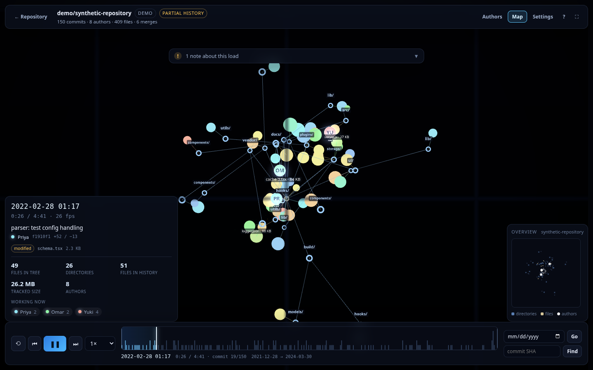
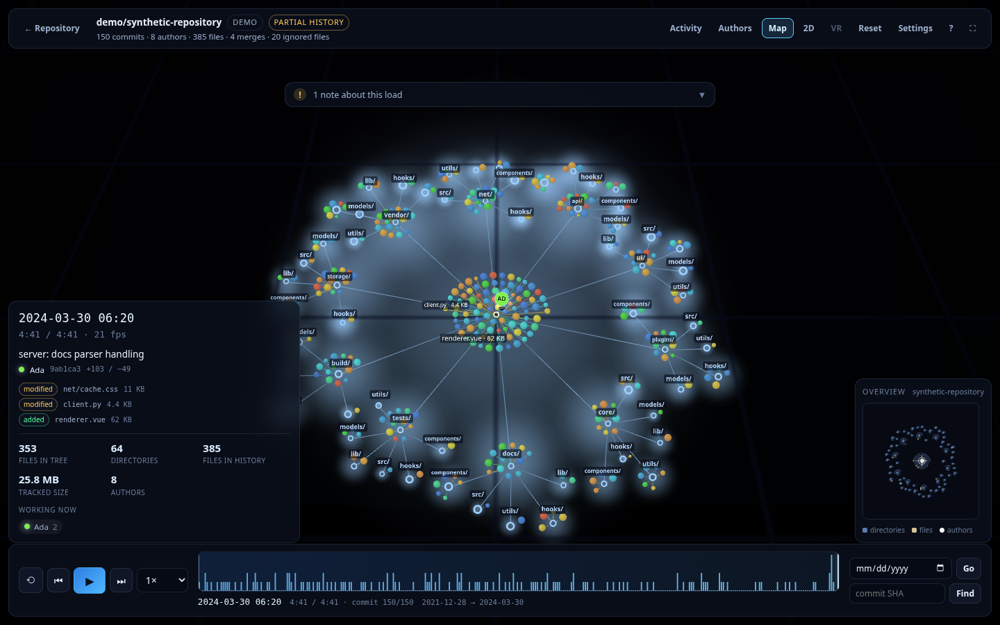
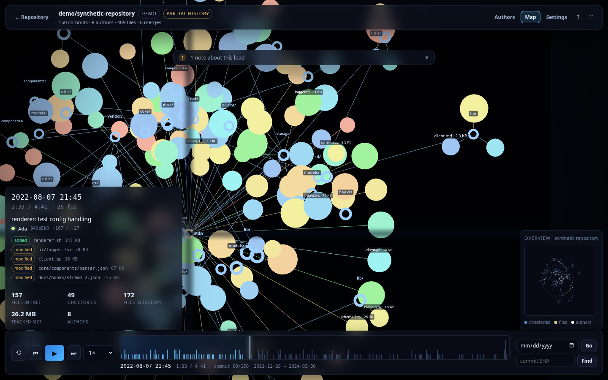
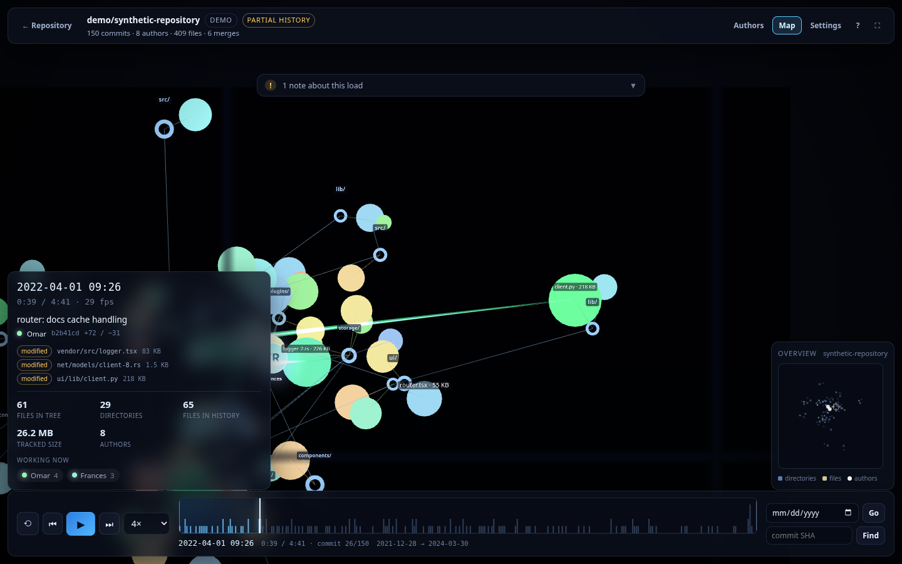

# Web Gource

A browser-based, WebGL-powered reimplementation of [Gource](https://gource.io/): paste one or more
public repository URLs and watch their histories grow side by side in one animated 3D map —
folders branching like trees, files and folders rendered as lit spheres sized by their real file
size, authors flying between the files they touch, and activity bursts coloured by add / modify /
delete / rename. Drag with the mouse to orbit around the scene.

Nothing is cloned, uploaded, or built on a server. Commit history is read straight from the
hosting provider's REST API in the browser, normalized into a timeline, and rendered with an
independently written Three.js renderer.



```
one or more repository URLs   →   animated 3D map of their histories
```

**Live:** <https://hdlopesrocha.github.io/web-gource/> — the published build is the same code as
`master`; the three-project synthetic demo works offline, and real repositories are fetched straight
from the host API in your browser.

## Quick start

```bash
npm install
npm run dev          # https://localhost:5173
```

`npm run dev` generates a self-signed certificate in `.cert/` on the first run and serves Vite over
HTTPS on every network interface. Open `https://localhost:5173` locally, or the **Network** URL Vite
prints from a phone, headset or another machine (for example `https://192.168.0.219:5173`). Browsers
warn that the certificate is self-signed; accept the warning for development, or import
`.cert/dev.crt` into your trust store. Reaching the server from outside your LAN also requires the
usual firewall/router port forwarding.

The certificate covers `localhost`, `127.0.0.1`, the machine's hostname and its current LAN IPv4
addresses. After changing networks, run `npm run cert:dev` and restart the dev server to regenerate
it.

Other scripts:

```bash
npm run build        # type-check + production bundle (dist/)
npm run preview      # serve the production build
npm run cert:dev     # regenerate the self-signed development certificate
npm test             # unit + component tests (mocked APIs, no network)
npm run test:api     # opt-in integration tests against the real GitHub API
npm run typecheck    # vue-tsc only
```

`npm run test:api` spends API quota; set `GITHUB_TOKEN` to use an authenticated quota and
`WEB_GOURCE_TEST_REPO` to test against another repository.

## Publishing

The site is a static build published to the `gh-pages` branch:

```bash
npm run deploy        # build, then publish dist/ to gh-pages
```

`scripts/deploy-gh-pages.sh` builds the project and copies `dist/` into a throwaway worktree of an
orphan `gh-pages` branch, so `dist/` is never committed and the source history is never rewritten.
It adds `.nojekyll` (so every asset is served verbatim), commits, and force-pushes the branch
(`DEPLOY_REMOTE=...` and `DEPLOY_BRANCH=...` override the defaults). Vite is configured with a
relative `base`, so the same build works both from a domain root and from a project subpath.

On GitHub, Pages must point at the branch once: **Settings → Pages → Source: Deploy from a branch
→ `gh-pages` / `(root)`**. The build then appears at `https://<user>.github.io/<repo>/`.

## Using it

1. Paste a repository URL — `https://github.com/owner/repository`, `owner/repository`,
   `git@github.com:owner/repository.git` and GitHub Enterprise / GitLab URLs all work.
2. Use **Add repository** to add another row and the **✕** button to remove one. Each filled row is
   its own project; the examples fill an empty row, or add a new one when every row is in use. With
   more than one row filled, the primary button reads **Load N repositories**.
3. Optionally add a token (see below) for a much larger quota and private repos. Tokens are per host;
   when the rows span several providers, a **Token host** selector appears so the token field edits
   one host at a time.
4. Press **Load Repository** — or **Load N repositories** when several rows are filled. Commit
   metadata is fetched first, then file changes are hydrated in small batches. A single repository
   starts visualizing as soon as its first batch is ready. Multi-repository runs download every row
   in parallel, merge the commits chronologically, and open the stage once the complete timeline is
   ready.
5. Play with it: scrub, seek, filter, and export a video.

### Multiple projects

The landing page can load several repositories into one shared scene. **Add repository** adds a row,
the **✕** button removes one, and the primary button becomes **Load N repositories** once more than
one row is filled. The Examples area also has **Fill 5 repositories**, which replaces the rows with
the `hdlopesrocha/lithos-engine`, `hdlopesrocha/vulkan-engine`, `hdlopesrocha/opencode-talk`,
`hdlopesrocha/web-gource`, and `hdlopesrocha/infinity-edge-web` samples in one click, oldest
repository first (it fills the form without starting a load). A single row still loads exactly as
before, with unscoped paths and authors.

Each project keeps its own file tree and its own author instances, so identical paths or the same
contributor in two repositories never collide. Paths are prefixed with `owner/name/`, and the same
person appears once per project — the Authors panel counts **author instances** and badges each with
its project. Authors are identified by their login and commit email: two people who share a username
but use different emails each get their own avatar and colour, and different logins sharing an email
also stay separate, while a display-name change from the same account remains one author. Hiding an
author hides that instance only in its project; the same person in another project stays visible.
Each repository is laid out as its own minimal volume directly under the scene root, with every file
and folder inside it. Projects occupy stable, evenly spaced slots on a ring; the ring widens evenly as
volumes grow, so groups never push each other around or merge into one cluster. The stage header
reports the repository/project count, and Settings → Data lists each project's commit and author
counts.

Repositories download in parallel. A single repository still streams live while it loads; a
multi-repository run waits for every source to settle, merges all commits into one chronological
timeline, and then starts playback from the beginning. Every project therefore joins at its own first
commit date and the animation ends only after the newest event in the merged history. Tokens are per
host, and a **Token host** selector appears when the rows span providers. A failed
repository does not abort the others: the successful projects stay loaded, a warning names the
failure, and the status reads **Ready · N of M repositories failed**. Downloads from a multi-project
run use an `N-repositories` name.

### Exporting video

Two export modes live in Settings → Recording:

**Deterministic render (default).** The animation is rendered frame by frame from
simulated time `t = 0` to the end of the timeline at **exactly 60 fps**, following
the **playback speed selected in the app**, so the file does not depend on how
fast the machine is:

* every frame advances the simulation by `speed / 60 s` and the commit index is
  derived from that time, so every frame is the same on every machine — a slow
  machine just takes longer (a 51 s animation at 4× rendered in software here
  took ~105 s of wall clock and produced the same 765 frames as a fast one);
* the video **contains the panels**: the info panel (date, commit subject, author,
  the files it changed with sizes, tree statistics, who is working now) in the
  bottom-left, the timeline histogram along the bottom, the overview (minimap) with
  its heading and the directories/files/authors legend in the bottom-right corner,
  and the activity charts — commits per weekday and hour, plus the sliding
  contribution calendar — in the right column. The overview is drawn by the same
  `MinimapDrawer` the on-screen panel uses, so the exported map and the panel cannot
  drift apart, and all four rectangles come from one pure layout function
  (`overlayLayout`) that reserves space for each panel, which is what keeps them from
  overlapping at any frame size — 720p, 1080p and portrait included;
* frames are drawn by the existing WebGL pipeline (`Engine.renderExportFrame`),
  at the resolution you pick, with the camera stepping on a fixed frame cadence
  rather than a wall clock;
* each frame is wrapped in a `VideoFrame` and handed to the browser's
  **WebCodecs** encoder, which is asked for a hardware implementation first and
  falls back to software (`prefer-hardware` → `no-preference` → `prefer-software`);
* frames are never accumulated: each one is encoded and released before the next
  is drawn, and the encoder queue is kept under a few frames, so memory stays
  flat for long exports. Only the compressed stream is retained;
* **WebM (VP9)** is the default output; **MP4 (H.264)** is offered when the
  browser has an AVC encoder. Containers are written in this repository
  (`src/engine/export/webm.ts`, `mp4.ts`) — no muxer dependency, and the track
  declares the export's frame duration so players report the real frame rate;
* **background music is mixed into the file** when a track is loaded: the MP3 is
  decoded once, looped and resampled to the video's exact length, faded in and
  out on the animation clock, and encoded as **Opus** for WebM or **AAC** for
  MP4. Audio and video end on the same frame;
* progress reports frames rendered, the total frame count, and the simulated
  time reached; cancelling stops cleanly and leaves the session where it was;
* at the end the encoder is flushed and the container is finalised (cluster
  flush, duration patched, MP4 durations patched), so the file is playable and
  contains every frame. `ffprobe` on a 51 s export at 4× reports `vp9`/`h264`,
  `1280x720`, `29999/500` (60 fps), `765` frames, `duration=12.750000`.

The *rendering* is deterministic; the encoder itself is not required to be
bit-exact (parallel VP9/H.264 encoders may vary by a few bytes), so two runs
produce the same frames and duration, not necessarily identical files.

**Live capture.** The older `MediaRecorder` + `captureStream` path samples the
composited frame in real time at 60 fps, following the same playback speed. It can
capture manual panning and zooming and includes the same panels, but the wall
clock decides how many frames reach the file — use the deterministic render when
the result has to be reproducible.

Both modes share the frame rate (60 fps) and the speed: there is no separate
recording speed setting, because the video should look like what you are watching.

### Background music

**Settings → Music** accepts an MP3. The track loops for the whole animation,
with a volume control and independent fade-in/fade-out lengths (0–10 s each):

* the fade-out always finishes with the final animation frame, so the last
  frame is silent; fade lengths are measured in video seconds, so they behave
  the same at any playback speed in the app and in the exported file;
* live playback follows the animation clock: pausing keeps the track position,
  and seeking, restarting or reaching the end re-seeks the loop to the matching
  point (accounting for playback speed); a browser that blocks autoplay retries
  when you press Play;
* deterministic exports decode the MP3 once and render the looped, faded audio
  into the container, so the audio track matches the video length exactly
  instead of depending on how many times the track happened to loop;
* live capture mixes the same envelope through Web Audio into `MediaRecorder`
  when the selected format can carry audio; if it cannot, the recording is
  video-only rather than failing;
* WebM uses Opus and MP4 uses AAC. If the browser has no encoder for the chosen
  audio codec, the export stops with an explanatory message — choose WebM or
  remove the track (Chrome on Linux, for example, currently has no AAC encoder);
* the uploaded file is kept for the current browser session only. Volume and
  fade lengths are remembered; the audio itself never leaves the browser.

**The microphone** can stand in for the MP3 file: the same tab has an **Audio source** choice of
*MP3 file* or *Microphone*. The microphone is opened with echo cancellation, noise suppression and
automatic gain control disabled, analysed live with the same bands, FFT size, smoothing and clap
detection as the file path, and fed through a gain node that carries the same fade-in/fade-out
envelope — so the reactive visuals keep fading in and out with the recording in either mode. Nothing
is routed to the speakers (no monitoring, no feedback). Live capture mixes the faded microphone into
the recording instead of the file audio, while the deterministic frame-by-frame export is
**video-only** in microphone mode, because a live input cannot be replayed identically twice.
Switching back to the file stops the microphone tracks and closes its audio context; a denied
permission leaves the file source selected and reports why.

**Audio-reactive visuals** are on by default and can be switched off in the same
tab. The decoded track is analysed once with an FFT (no `AnalyserNode`, so the
result does not depend on the machine's real-time performance) into a few
envelopes sampled every ~21 ms:

* **bass** (25–150 Hz) rotates the plasma's hue and makes it
  breathe;
* **claps** — short transients in 1.8–5.8 kHz — cycle and flash the file
  colours, so the palette changes with the beat;
* **low mids** (150–400 Hz) tint the folder spheres, and the **midrange**
  (400–2000 Hz) brightens the branch lines;
* the **vocal range** (300–3400 Hz) makes the author avatars and their halos
  pulse.

Live playback samples the position of the looping audio element, so the
reaction matches what is actually heard. Deterministic exports sample the same
envelopes at the video timestamp (and apply the same fade envelope), so exported
frames are reproducible. Switching the toggle off only stops the reaction; the
track keeps playing and is still included in recordings and exports.

### Ignoring folders

Repositories contain trees nobody wants to watch — `node_modules`, `vendor`, `third_party`,
generated output. **Settings → Filters** has an **Ignored folders** list that removes them:

| entry | hides |
| --- | --- |
| `third_party` | any folder with that name, at any depth, case-insensitively |
| `third*` | folders matching the glob (`third_party`, `third-party`, `thirdparty`) |
| `src/vendor` | that one path (and everything under it) |

Folders only: a *file* named `third_party` is untouched, and the last segment of a path is always
treated as the file. Entries are trimmed and deduplicated, so a pasted list works the same on every
host.

**Hidden folders** have a toggle of their own in the same tab (on by default): any folder whose name starts with a dot —
`.github`, `.vscode`, `.husky`, `.cache`, `.idea` — is tooling rather than code, so it stays out of the
visualization. Hidden *files* are left alone: a root `.gitignore` or a `.eslintrc.json` still appears, because
the filter only ever looks at directory segments. `.*` is not an ignore-list entry, precisely because it would
read as a glob that matches every folder.

Ignoring filters **file changes, not commits**: a commit that only touched ignored folders still
plays (its author and message are history), it simply has no files to highlight, and its
additions/deletions are recomputed from the changes that remain — the counters never include hidden
trees. A rename that moves a file *out* of an ignored folder is kept as an addition, because the old
path is not part of the visualization. The list is stored locally and survives a reload;
**Clear every filter** (in Settings → Filters or the Authors panel) empties it along with the hidden-folder
toggle, the author and the date filters. Per-author toggles and the date range stay in the Authors panel
(`A`); the folder filters live in Settings → Filters.

### Personal access tokens

Tokens are optional, never required for public repositories, and always stored locally in the
browser — there is no backend.

* The field is **always editable**, including before a repository URL is known: type or paste a
  token, then paste the URL, and the token is attached to the matching host automatically.
* A **Paste** button reads the clipboard directly where the browser allows it; native
  `Ctrl`/`Cmd`+`V` works too (nothing in the app intercepts paste).
* Pasted values are cleaned up: spaces, line breaks, zero-width characters and an accidental
  `Bearer ` prefix are removed.
* Host attribution uses the token prefix — `ghp_…` / `github_pat_…` for GitHub,
  `glpat-…` / `glrt_…` for GitLab — and a token is **never** sent to a different
  host. Unrecognised tokens are kept until the URL identifies the host.
* Tokens are committed on blur, on Enter, or shortly after typing stops, so a half-typed token is
  never stored. Focusing the field selects the existing value, so one paste replaces it.
* The last repository URL and every token are restored after a page reload.
* A token added mid-session (Settings → Data → Access token) can be applied with
  **Reload repository with this token**: cached commits cost no quota, so this mainly fills in the
  file changes that were skipped when the limit was reached.

### Keyboard and mouse

| Input | Action |
| --- | --- |
| `Space` | Play / pause |
| `←` / `→` | Previous / next commit |
| `Shift` + `←` / `→` | Seek 5 seconds |
| `Home` / `End` | Jump to the start / end |
| `+` / `-` | Faster / slower |
| `R` | Restart playback |
| `C` | Reset the camera to the default 3D view |
| `L` | Toggle labels |
| `M` | Toggle the minimap |
| `A` | Toggle the authors panel |
| `S` | Toggle settings |
| `F` | Fullscreen |
| `?` | Help |

The 3D view is a tabletop: the camera up vector is the plane normal (+Z), so a left-drag spins the
camera around the tree and tilting changes the elevation above the plane while the ground recedes
into the distance. Right-drag (or Shift-drag) pans and the scroll wheel zooms around the pointer.
**Reset** (or `C`) returns to the default 3D angle. Manual input pauses the automatic view for a few
seconds.

### Phones and tablets

The stage adapts below **760px** wide and on short landscape phones. The header becomes two rows
so every action stays reachable, notices stack below it, and the playback bar uses a portrait column
or one compact landscape row. Authors, Settings and Activity open as full-width sheets above the
playback bar with independently scrolling bodies; Help and the compact minimap stay available. Safe
area insets keep controls clear of notches and home indicators (`viewport-fit=cover`), and the stage
uses the dynamic viewport height so mobile browser chrome does not clip it. Desktop layout is
unchanged from 900px up.

### Gamepad and head tracking

The camera can also be flown directly, which is what turns the 3D view from a
picture into a place. Both devices are opt-in in **Settings → Camera → Gamepad &
head tracking**, and until one of them is enabled *and* actually reporting,
nothing about the camera changes.

A gamepad (standard mapping) flies a free 6-DOF camera:

| input | action |
| --- | --- |
| left stick | rotate: yaw (left/right) and pitch (away/towards) |
| right stick | roll (left/right) and thrust (away/towards) |
| D-pad | strafe (left/right) and rise / sink (up/down) |
| RT / LT | forward / back thrust (analog, added to the stick) |
| A / cross | recalibrate the head tracking |

Rotation is applied as a quaternion delta in the camera's own frame, so the sticks
behave like a head-mounted rotation and roll is possible at all — an orbit camera
cannot express roll, which is why a pad switches the view into a free mode. The
orbit state is remembered: **Reset** (or simply dragging with the mouse) hands the
camera straight back to the automatic tabletop view, and the automatic follow
never fights the sticks while you fly.

**Head tracking** follows the device's gyroscope: the camera orientation is the
device orientation mapped into the scene, and its up vector is the device's up
rotated by the gyroscope value — so the horizon follows your head instead of
staying glued to the plane. Because the sensor is absolute, a click on the scene
(or the gamepad's A button) **recalibrates** it: the current device pose becomes
the reference and the view does not move, so you can aim the scene exactly at the
orientation you are holding, hand the device to someone else, or turn away and
back, and one click re-aims it without a jump. iOS asks for motion-sensor
permission the first time the toggle is switched on; a refusal is reported in the
panel instead of failing silently.

### VR and 3D spheres

The stage toolbar has a **VR** button that opens the same scene in an immersive WebXR session:

* support is probed once with `navigator.xr.isSessionSupported('immersive-vr')`. When the browser
  has no XR device (or no `navigator.xr` at all) the button is disabled and says so, instead of
  failing when it is pressed;
* entering a session enables `renderer.xr`, requests the `local-floor` reference space and stands you
  at the **scene origin** over the centred tree (the tree keeps its tabletop scale). Leaving the
  session (or the headset ending it) restores the exact previous camera and scene transform;
* while a session is running the frames come from the XR animation loop;
* **files and folders are always real spheres** — instanced `SphereGeometry` with a light,
  world-scaled and depth-tested. The same representation is used on screen and in VR, where
  camera-facing billboards would read as discs;
* **the whole interface comes with you**: one WebGL-rendered plane is placed centred in front of the
  headset and takes the headset's own orientation, so it is square to you when it appears. It carries
  the header (repository summary and page buttons), the stage cards (commit details, stats, overview
  minimap, load notices), the footer timeline with the commit histogram, playhead, date and progress,
  and dedicated **Activity**, **Authors**, **Settings**, **Help** and **Warnings** pages. Its centre
  is left transparent, so the tree stays visible through the middle of the screen. It is fixed once
  placed, so gaze can sweep across it;
* **the screen is driven by gaze**: a circular crosshair sits at the centre of your view and an
  element activates once it rests on it for **2 seconds**, the ring filling over that time and the
  hovered control highlighted. Looking away or moving to another control resets the dwell, so
  nothing fires by accident. Repeatable controls (stepping, seeking, page turns, volume, view
  height) re-arm after they fire, while toggles wait for you to look away. The gaze ray is cast from
  between the eyes through the plane;
* three camera views are available from the in-scene menu and the desktop toolbar: **Origin** (close to
  the scene origin, looking at the scene), **Top** (straight down over the whole scene) and
  **Gource** (the Gource view raised, watching the damped focus of recent activity). The headset adds
  look-around in all three. **Settings → Camera → View height** (default 4 m) sets how high Top and
  Gource sit. **Zoom + / −** (next to the view buttons in both the menu and the desktop toolbar)
  dollies the camera along its own view direction;
* the menu translates with the camera whenever it moves, but its orientation is never changed;
* **recenter** only moves the menu: it is re-placed centred in front of you and the camera is left
  untouched, so it keeps watching the action. Pulling the XR trigger, a tap on the mirrored desktop
  canvas, and the in-screen **Recenter** button all do the same thing;
* the transport controls cover restart, previous commit, play/pause, next commit, speed and the three
  camera-view buttons.
  The speed button cycles the same 0.25×–32× presets as the on-screen selector. **Exit VR** leaves the
  session from inside the headset;
* nothing here is required for the normal view: without a headset the app behaves exactly as before,
  and the deterministic export ignores the XR state.

## How it works

```
src/
  git/                      data acquisition
    url.ts                  URL parsing / normalization (bare, SCP-like, UI routes, .git)
    http.ts                 fetch with retries, backoff, abort and rate-limit classification
    cache.ts                two-level cache (memory + IndexedDB); payloads are immutable by SHA
    pool.ts                 bounded concurrency for per-commit requests
    errors.ts               typed errors + actionable messages
    loader.ts               staged loading: metadata → commit list → batched file hydration
    providers/
      types.ts              GitProvider interface (parse, repo info, commit pages, hydrate, URL)
      github.ts             GitHub.com + GitHub Enterprise
      gitlab.ts             GitLab.com + self-managed (beta)
      demo.ts               deterministic synthetic history for offline demos and load testing
      index.ts              provider registry, URL → provider resolution, token plumbing
  timeline/                 normalized history
    types.ts                Timeline, TimelineCommit, TimelineAuthor, change kinds
    builder.ts              raw commits → timeline (+ author aggregation, stats, filters)
    ignore.ts               folder ignore list (names, globs, path prefixes)
    schedule.ts             deterministic playback schedule and date ↔ time mapping
  sim/                      repository state, independent of rendering
    layout.ts               deterministic path → position mapping (stable under filtering/seeking)
    simulation.ts           path tree, visibility over time, authors, activity events
  render/                   WebGL layers (Three.js)
    renderer.ts             scene composition, event consumption, settings, sizing
    nodes.ts                instanced file/directory nodes with capacity growth
    edges.ts                branch edges as a single growable line buffer
    particles.ts            additive particle pool for activity effects and author trails
    authors.ts              pooled avatar sprites with a texture cache
    labels.ts               world-space labels, constant screen size, LRU texture cache
    camera.ts               orbit camera with Gource-style automatic framing
    minimap.ts              2D overview of the tree, authors and camera position
    palette.ts              extension/author/change colours
    textures.ts             canvas texture caches (labels, avatars, ball sprites)
  engine/
    engine.ts               playback clock, simulation driving, camera, HUD, recording hooks
    controller.ts           app orchestration: load, filters, seek, settings, recording
    recorder.ts             MediaRecorder + canvas.captureStream export (live capture)
    audio/
      music.ts              MP3 decode, looping playback, fade and loop helpers
      analysis.ts           FFT band envelopes, vocal presence and clap detection
    export/                 deterministic frame-by-frame export
      audio.ts              Opus/AAC encode of the looped, faded soundtrack
      frames.ts             60 fps frame plan: time, timestamps, keyframes, progress
      encoder.ts            WebCodecs encoders (hardware first, software fallback)
      exporter.ts           frame loop, backpressure, cancellation, finalisation
      webm.ts               WebM/Matroska muxer (VP9/VP8/AV1)
      mp4.ts                fragmented MP4 muxer (H.264)
  state/store.ts            reactive app state, settings persistence, token storage
  ui/*.vue                  landing view, stage, playback bar, scrubber, panels, help
tests/                      unit, component and (opt-in) live API tests
```

The boundaries are deliberate: providers only translate API payloads, the timeline knows nothing
about rendering, the simulation is pure logic, and the renderer reacts to simulation events. That
is what makes seeking, filtering and deterministic replay cheap.

### Data model and honesty about gaps

Every provider returns the same normalized structures (`RawCommit`, `RawFileChange`, `RepoInfo`).
Commits keep their SHA, author identity, timestamps and message verbatim; file changes keep path,
previous path (renames), change type and line counts.

When something cannot be fetched it is **marked, never invented**:

* `filesMissing: 'rate-limit'` — the API quota ran out before file data was fetched.
* `filesMissing: 'merge-parents'` — a merge commit the host reports without a changed-file list.
* `filesMissing: 'error'` — the detail request failed (the commit itself is still shown).
* `filesMissing: 'not-requested'` — the commit list was loaded without file hydration.
* `filesTruncated: true` — the host capped the file list (GitHub: 300 files).

The UI shows these as badges, counts them in the Data tab, and explains them in the notes strip.
Directories, files and authors are only ever created from real commit data.

### Rate limits, caching and incremental loading

GitHub allows **60 requests/hour** anonymously; a token raises this to 5,000. Because file changes
cost one request per commit, the app budgets requests instead of pretending:

* the commit list is cheap (1 request per 100 commits) and always fetched first;
* file hydration runs in batches of 10, oldest first, with bounded concurrency (6 requests); a
  single-repository run starts as soon as the first batch arrives and grows while loading, while
  multi-repository runs merge after every source settles;
* commits with detail requests still pending or skipped are rendered without file activity;
* when the quota drops to the reserve, hydration stops, the commits already fetched are kept, and
  a warning explains how to continue (token, smaller snapshot, reload — cached data is reused);
* every fetched repository, commit and hydrated commit is cached (memory + IndexedDB), so reloads
  and re-filters cost almost no quota;
* loading can be cancelled at any time and cleans up in-flight requests.

Snapshot size (50 → 4,000 commits) and range (newest commits, or from the first commit of the
repository) are user choices, because the full history of a large repository cannot fit in any
quota. The app states which window it loaded and why.

### Determinism

Given the same history and settings, the same sequence of events is produced:

* the schedule is a pure function of commit timestamps with a fixed, documented compression curve
  (`gapTime = perGapCap · (1 − e^(−gap/gapTau))`, with a global idle budget);
* node positions derive from the *path* hash, not from arrival order, so the layout is identical
  under filtering, seeking or incremental loading;
* visibility over time is stored as per-node toggle indexes, so `seek(i)` is an exact
  re-evaluation instead of an approximation;
* nothing in the simulation depends on wall-clock time or randomness.

### Rendering



* Files and folders are two `InstancedMesh` objects of real `SphereGeometry`, both shaded by a shared
  ambient + key light. There is no billboard or flat 2D element path: the spheres keep their true
  world radius, so near nodes are genuinely larger and the tree gains parallax as the camera moves.
  The radius still encodes the real file size. Layer order: the backdrop gradient, then branches, the
  camera-following grid, the activity plasma, spheres, particles, rays, avatars and labels (front).
  Every element layer is depth tested, so a nearer sphere occludes a branch, a ray, a particle or a
  plasma blob behind it. Both layers grow by reallocating and copying instance buffers when a
  repository turns out to be larger than expected.
* The sphere palette carries the file extension / activity / monochrome colour, while folders keep
  their directory colour. Change highlights and the audio-reactive claps tint the lit material, so
  the surface shading and the activity signal remain visible together.
* Branch edges share one `LineSegments` buffer with two vertices per node. They are opaque and
  depth tested, so the node spheres (drawn slightly in front) **occlude** them — a branch disappears
  behind a file or folder sphere instead of being painted across it — and every segment is trimmed
  by the radius of both endpoints, so it starts at the parent's edge and stops at the child's edge.
  A branch whose two spheres already touch is dropped rather than drawn as a stub inside one.
* Activity effects and author trails come from a single additive `Points` pool with a free-list (no
  allocations per commit); particle sizes are given in screen pixels, so sparks stay the same size
  at any zoom level. The author→file beam quads are also billboarded towards the
  camera, so they keep facing it while it orbits.
* Author→file beams are one dynamic mesh rebuilt per frame (two quads per beam: glow + core), so a
  commit touching twenty files still costs a single draw call. They are depth tested like the rest of
  the scene, so a beam that passes behind a file or folder sphere is occluded by it instead of
  painting across it. By default the beam is **directional**:
  a bright head leaves the avatar and travels to the file or folder it changed, with a comet tail
  following it and the far end of the soft glow brightening as it arrives — so a change reads as a
  signal being sent. Settings → Visual offers `Travelling head` (default) or `Solid ray` (the original
  full-length line, unchanged) plus the travel time (0.15–2 s).
* Labels are pooled sprites with an LRU canvas-texture cache and screen-space overlap rejection, so
  dense repositories stay readable. Their world size is derived from the view depth of each label,
  keeping the text at a fixed pixel height anywhere on the tilted plane. File labels can include the
  host-reported size.
* The background is a full-screen gradient shader that is independent of the orbit angle. A
  camera-following grid keeps panning, orbiting and zooming readable. The grid is a transparent
  overlay, so depth testing (not the draw order) is what keeps it behind the tree: the spheres
  write depth first and the grid is rejected wherever they cover it. The depth stack is explicit —
  grid −0.6, branches 0, spheres +0.25, effects +0.5. The minimap shows the whole tree
  with the current view position.
* The **activity plasma** (`PlasmaField`) is a ray-marched density volume that forms around the
  files with the most recent changes. Every file carries a heat value in 0…1, bumped by each
  activity event and decaying exponentially (5 s by default); the hottest files (up to 64) become
  spherical metaball sources whose strength and radius both scale with their heat, so a cold file
  contributes nothing and heat alone drives the blob in and out. The summed field is rasterised into
  a 128² texture each frame and the fragment shader marches the slab covering the sources, which
  keeps the per-pixel cost bounded instead of looping over every file. It is drawn **after** the
  branch lines and the spheres, with the depth test on, so their silhouettes clip the volume instead
  of the volume washing across them; particles, beams, avatars and labels still draw on top. It is
  tinted by the shared activity tint, and its own `opacity` scales how much of the volume is
  added — the shipped default (intensity 0.50, full opacity) draws a dim, defined surface. Settings → Visual
  toggles it and exposes the intensity, opacity, surface sharpness, metaball weight, blob radius,
  heat decay, volume height and march quality.
* Resizing, device pixel ratio and full disposal (geometries, materials, textures, renderer) are
  handled in one place (`SceneRenderer`).

### Dynamic layout — Gource's model



Folder and file placement follows the algorithm in Gource's own source
(`src/dirnode.cpp`), adapted for files that have a size:

* **A directory's radius is the square root of the area it needs**
  (`RDirNode::calcRadius`): `radius = sqrt(area) * 1.5`, where the area is the
  sum of the file areas in its whole subtree. A folder's *own* files get their
  own radius (`parent_radius` in Gource), and that is the radius its children are
  placed against. Because everything scales with the square root of the content,
  the extent of the tree grows with `sqrt(files)` rather than with nesting depth.
* **Files are grouped on concentric rings around their folder**
  (`RDirNode::updateFilePositions`, `calcFileDest`). Ring radii step outwards by
  one "file diameter", each ring holds as many files as fit around its
  circumference, and slots are spread with a half-slot offset. Gource spaces its
  rings by the fixed 8-unit file diameter; here the spacing follows the widest
  circle in the folder and each slot's angle comes from the chord that circle
  actually needs, so a folder full of large files still packs tightly without
  overlapping.
* **Directories are placed by a force relaxation** (`RDirNode::applyForces`):
  gravity towards the ideal clearance from the parent
  (`|Δpos| − (dirRadius + parentOwnRadius)`), a push along the parent's own
  direction so children fan outwards, repulsion from siblings scaled by the
  parent's radius over its child count, and overlap resolution against every
  nearby directory.
* Gource resolves overlaps with a spring far weaker than its gravity, so crowded
  parents end up with overlapping clusters. Here each relaxation ends with a
  **projection sweep** instead: overlapping bodies are pushed apart by the
  smallest distance that clears them, and a folder may sit inside its ancestors'
  clusters (it only has to clear their own files). The result keeps Gource's look
  — folders fan out and settle at their ideal distance — while nothing overlaps:
  no two file circles, no two folder rings, and no file crossing a folder that is
  not its parent.
* A new folder starts next to its parent with a hashed offset
  (`RDirNode::setInitialPosition`), and a folder that moves carries its own files
  with it (and, while it is first taking its place, its whole subtree).
* The expensive part (the forces) runs every fourth commit; the projection runs
  after every commit, so a growing circle is separated immediately while folders
  drift into place over a few commits. A full reflow (seek, size change, filter)
  relaxes much longer and projects until clean.

Replaying 5,000 commits over 3,600 files costs a few seconds of layout work, and
the tests assert the no-overlap contract while playing, after host sizes arrive
and after a seek.

* Settings → Visual can switch the dynamic layout off, which eases every file
  back to its path-derived position for a static map.
* Positions remain a pure function of the applied commits, so seeking forward to
  a point in history produces exactly the layout that playing to it would.

### Activity heatmaps

The Activity panel (`H`, or the button in the header) answers "when did this work happen":

* **commits per weekday and hour** — a 7 × 24 density grid in UTC, with a hover readout per cell and the busiest
  slot in the header;
* **contributions over the last 53 weeks** — a GitHub-style calendar of per-day commit counts, five shade steps
  and month labels. The rightmost column is always the week of the *current* commit date, so the calendar slides
  as playback advances (and days that have not happened yet stay empty).

Both charts follow the **playback position**: they count only the commits that have already happened at the
current commit date, so scrubbing backwards removes the future instead of showing the whole history at once, and
the calendar's rightmost column always sits on the current week. They also aggregate the filtered timeline, so
hiding authors, ignoring folders or narrowing the date range changes what they count. Both are drawn on canvas at
device pixel ratio with a hover readout per cell, and the exported video draws the same charts from the same code,
growing frame by frame as the animation plays.

The scene's activity plasma is built on the same idea — each change adds heat to the file it touched
and the light decays over a few seconds — but it lives in the 3D scene rather than in these charts;
see [Rendering](#rendering).

### Reading the activity



Every commit is visible while it happens:

* the files it touched **pulse** in the colour of the change (green added, amber modified, red
  deleted, violet renamed) and briefly grow, so a one-line edit in a large tree is still findable;
* a **beam** (the Gource tether) connects each changed file to the author who made the change: a
  bright core with a soft glow, drawn as camera-facing quads so the width is controllable, fading
  out after about 1.6 simulated seconds. Its **width and brightness follow the size of that
  change** (line churn, with the file's size as a secondary factor, normalised against the largest
  change in the window), so a 1200-line commit draws a much stronger ray than a one-line tweak;
* authors are drawn **above** everything else — branches, spheres, particles and rays — so the
  avatars are never hidden while they work;
* avatars travel between files with a critically damped spring and a speed limit instead of
  jumping, so you can follow a contributor across the tree; new contributors fly in from outside
  the tree;
* timings are in *simulated* seconds, so the highlight and the beams stay in step with the commits
  at any playback speed.

Beams can be switched off or restyled (brightness, width) in Settings → Visual.

### File sizes on screen

Sphere size is a first-class signal, not decoration:

* Sizes come from the host's own file listing for the newest commit in the loaded window — one
  extra request (GitHub's recursive tree endpoint), cached, never one request per file.
* The scale is logarithmic with a mild power curve against the **95th percentile** of the window,
  so small files stay visible and a single generated file cannot flatten everything else. The
  Settings panel shows a legend with the exact mapping and reports how many spheres use a real size.
* Files the host does not report (or every file, when the listing is unavailable or truncated) fall
  back to accumulated line activity, and the UI says so instead of pretending.
* Labels of just-changed files show the size (`renderer.ts · 14 KB`), the activity overlay lists the
  size of every changed file, and the Data tab reports the tracked total.
* The mapping can be switched between file size, line activity and uniform spheres; a global
  multiplier scales all spheres.

### Video export

Export uses `MediaRecorder` with `HTMLCanvasElement.captureStream()` — everything stays local.

* Formats are probed at runtime: WebM (VP9/VP8) where supported, MP4 (H.264) where the browser can
  produce it. Unsupported codecs are shown as disabled rather than offered.
* Resolution presets (720p → 1440p, square, vertical), frame rate (15–60) and playback speed during
  recording (0.25× → 16×) are configurable, and the estimated recording time is shown.
* While recording, the renderer switches to the chosen resolution and the clock advances by exactly
  one frame step per captured frame, so the video is a faithful, deterministic sampling of the
  timeline.
* Progress (percent, frames, elapsed, size) is reported live; recording can be stopped manually,
  stops automatically at the end of the timeline, and has a safety time limit.
* With background music loaded, live capture mixes it into the recording when the selected format
  can carry audio; in microphone mode the faded microphone is mixed in instead and the deterministic
  render is video-only. Otherwise the deterministic render encodes its own Opus (WebM) or AAC (MP4)
  track for the exact length of the video.
* Keep the tab focused while recording: background tabs throttle rendering.

## Testing

`npm test` runs 387 tests with mocked provider payloads — no network access:

* URL parsing (bare input, SCP syntax, `.git`, UI routes, nested GitLab groups, Enterprise hosts);
* GitHub provider: pagination, cache reuse, rename/delete/copy mapping, 300-file truncation,
  merge commits, failing detail requests, quota exhaustion, empty repositories, 404/403/401;
* token handling: sanitising pasted values, host detection from prefixes, drafts attached once the
  host is known, no cross-host leakage, clearing, and persistence across reloads;
* timeline builder: ordering, dedupe, author aggregation, rename normalization, missing file data,
  filters, extension/path statistics;
* schedule: monotonicity, idle compression bounds, append stability, time ↔ date mapping;
* simulation: directory creation, delete + re-add visibility, renames, unknown-path modifications,
  merge commits, seek ≡ replay, no double counting on replay, author behaviour, bounds;
* activity: avatar motion is continuous and bounded by the speed limit, tethers are created per
  changed file, refreshed, expired and capped, beams fade, follow both endpoints, scale with zoom
  and respect their capacity;
* branch lines: endpoints stay outside both spheres, a branch between touching spheres is dropped,
  the material stays opaque so the node pass occludes it, and the dimming is baked into the vertex
  colours;
* activity beams: brightness and width scale with the size of the change, endpoints follow both
  the avatar and the node, and the author layer renders above the rays;
* dynamic layout: Gource's radius model (square root of the area), file grouping on rings (no
  overlaps, grows with count and size, deterministic), the force relaxation (ideal clearance,
  siblings spread, overlaps projected apart), and the no-overlap contract (clusters, file
  circles, file vs. folder rings) while playing, after sizes arrive and after a seek;
  in the simulation, adding, deleting or growing a file moves its siblings smoothly, folder
  clusters (including nested ones) never overlap and stay inside their parent's cluster, growing a
  folder pushes its siblings outwards, seek and playback produce identical layouts, and the static
  mode pins nodes to their path-derived positions;
* export containers: EBML/box structure written back and parsed (clusters per keyframe, simple
  block payloads, patched durations, `avcC`, Opus headers, AAC `esds`, audio tracks and fragments,
  fragment data offsets, byte-exact sample payloads), and the export loop (60 fps frame plan,
  keyframe cadence, frame release, queue bounds, progress, cancellation, encoder errors, MP4
  initialisation from the encoder metadata);
* background music: fade-in/fade-out envelope, seamless looping, resampling, live clock mapping,
  and the deterministic audio encode/mux path for both WebM (Opus) and MP4 (AAC);
* music analysis: band isolation for bass, folders, lines and the vocal range, sparse-transient
  clap detection with onset counting, silence, low sample rates, and sampling outside the track;
* audio-reactive layers: claps cycling file colours and restoring the palette when the track
  stops, bass rotating the plasma's hue, and midrange brightness on the branches; the controller
  provider (live position sampling, export timestamps, the pause freeze and the on/off toggle);
* microphone: the capture graph and its gain, the shared fade envelope (kept while recording), live
  band analysis matching the batch bands, the recording mix, teardown, and permission failures;
* the plasma field: heat bumping and exponential decay, heat-gated source selection (hottest first,
  capped), volume bounds and rasterised density, the audio hue/brightness match with the shared
  activity tint, setting clamps (opacity included), and its render order after the spheres and before every
  later transparent layer;
* the exported overlay: the panel layout at 720p, 1080p and portrait (no overlaps), the overview
  heading, legend and map drawing inside the panel, and `overview: false` skipping it;
* VR and spheres: WebXR support detection and error paths, session enter/exit and the end-event
  restore (against fakes, since there is no headset in CI), and the sphere-only node field (lit
  sphere geometry for files and folders, world-scaled transforms, colours, hidden nodes, capacity);
* rendering bookkeeping: instance allocation, capacity growth, hidden nodes collapsing on both dirty
  *and* full syncs (a seek or restart must not leave the previous frame on screen), every layer
  dropping its instances when the history is rebuilt (node ids are per simulation, so a filter change
  must not keep rendering the old tree), edge buffers, particle
  pool limits and decay, and tabletop orbit (plane-normal up vector)/pan/zoom;
* controller end-to-end flows with a mocked API: loading, filters, SHA/date jumps, cancellation,
  WebGL-unavailable degradation;
* component smoke tests (jsdom) for the landing view, playback bar, stage, panels and help overlay;
* file sizing: logarithmic mapping monotonicity and bounds, 95th-percentile reference, fallbacks
  for unknown sizes, size-mode switching, sizes arriving after nodes exist, host tree parsing;
* scale checks: 5,000 commits and ~3,600 files build in ~0.1 s and seek in well under a frame.

`npm run test:api` additionally validates the parsers against the real API (field names, pagination
headers, file change shapes) and skips gracefully when the quota is exhausted.

## Limitations

* **GitHub and GitLab only.** Other hosts need a new `GitProvider`; the registry is one entry plus
  a `parse` method.
* **No GraphQL batching.** GitHub's REST API is the only way to get per-commit file paths, so cost
  is one request per commit. Token-authenticated loads make this practical.
* **Windows of history, not full histories.** A very large repository cannot be fully fetched in a
  browser without a token; the UI is explicit about the loaded window.
* **File contents are not fetched.** Only paths, change kinds, line counts and (via the tree
  endpoint) byte sizes for the newest commit in the window.
* **Sizes are a snapshot, not a history.** A file that shrank during the window is drawn at its
  current size; tracking size over time would need one tree request per commit.
* **Synthetic avatars.** Profile pictures from the host are not fetched: generated initials keep the
  scene deterministic and avoid third-party requests.

## Legal

Inspired by the original [Gource](https://gource.io/) by Andrew Caudwell. This is an independent
implementation with its own renderer and shares no code with, and is not affiliated with, the
original project. Repository data belongs to the respective projects and is fetched from their
hosting provider's public API.
